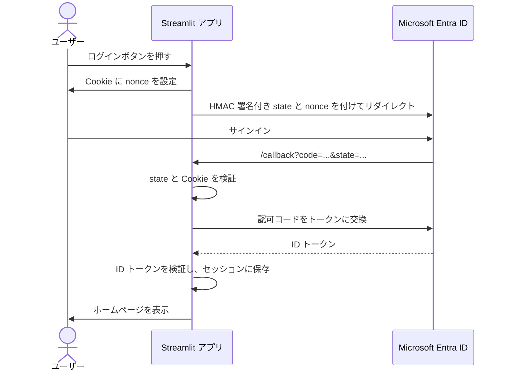

# 🔐 Entra ID Auth Example

[](https://github.com/nncdevel-io/streamlit-auth-with-microsoft-entra-id-example/actions/workflows/ci.yml)


[](LICENSE)

StreamlitアプリケーションにMicrosoft Entra ID（旧Azure AD）認証を組み込むサンプル実装です。

## ✨ 機能

| | 機能 |
| --- | --- |
| 🔑 | Entra IDによるシングルサインオン（SSO） |
| 👤 | IDトークンからのユーザー情報取得 |
| 🚪 | ログイン・ログアウト機能 |
| 🛡️ | 認証必須ページのガード機能 |
| 🍪 | Cookie + HMAC署名によるCSRF対策（Double Submit方式） |
| ✅ | PyJWTによるIDトークンの検証（署名、発行者、対象者、有効期限、nonce） |
| 🧭 | `st.navigation()` APIによるマルチページ構成 |

## 📋 必要条件

- Python 3.13以上
- uv
- Microsoft Entra IDテナント
- Azure Portalでのアプリ登録

## 🚀 セットアップ

### 1. 依存関係のインストール

```bash
make install-dev
```

### 2. 環境変数の設定

```bash
cp .env.example .env
```

`.env`ファイルを編集し、Entra IDの設定を入力します。

```bash
AZURE_CLIENT_ID=xxxxxxxx-xxxx-xxxx-xxxx-xxxxxxxxxxxx
AZURE_CLIENT_SECRET=your-client-secret
AZURE_TENANT_ID=xxxxxxxx-xxxx-xxxx-xxxx-xxxxxxxxxxxx
AZURE_REDIRECT_URI=http://localhost:8501/callback

# 企業プロキシ環境の場合（任意）
SSL_CA_FILE=/path/to/your/ca.pem
```

> [!NOTE]
> **企業プロキシ環境について**: HTTPSトラフィックを検査する企業プロキシの環境では、
> `SSL_CA_FILE`にプロキシのCA証明書パスを設定してください。
> Python 3.13ではSSL検証が厳格化（`VERIFY_X509_STRICT`）されており、
> AKI拡張のないCA証明書が拒否されるため、本アプリでは`SSL_CA_FILE`設定時に
> このフラグを自動的に無効化します。

### 3. Azure Portalでのアプリ登録

1. Azure Portal → Microsoft Entra ID → アプリの登録 → 新規登録
2. リダイレクトURIに `http://localhost:8501/callback` を追加
3. 「認証」→「IDトークン」を有効化
4. 「証明書とシークレット」→ クライアントシークレットを作成
5. 「APIのアクセス許可」→ `openid`, `profile`, `email` を追加

## ▶️ 実行

```bash
make run
```

ブラウザで `http://localhost:8501` にアクセスします。

## 🏗️ アーキテクチャ

### マルチページ構成

`st.navigation()` APIを使用し、`app.py` がルーター兼共通レイアウトとして機能します。

```bash
app.py              # エントリポイント（ルーター + 共通レイアウト + OAuthコールバック処理）
pages/
├── home.py         # ホームページ（ログイン/ユーザー情報表示）
├── about.py        # Aboutページ（認証不要）
├── dashboard.py    # ダッシュボード（認証必須）
└── profile.py      # プロファイル（認証必須）
```

### 認証フロー



1. ユーザーがログインボタンを押す
2. Cookie にnonceを設定し、HMAC署名付きstateをパラメーターとしてEntra IDへリダイレクト
3. Entra IDで認証後、認可コード付きでアプリにリダイレクト
4. `app.py` がコールバックを検知（`?code=`）し、state/Cookie検証後にトークン交換
5. セッションに認証情報を保存し、ホームページを表示

### 標準的な実装との違い

> [!WARNING]
> このサンプルには、Streamlit の制約などから標準的な実装とは異なる作りにしている箇所があります。
> 本番で使う場合は、各項目の「本来の形」を検討してください。

#### OIDC の nonce

| 項目 | 本来の形 | このサンプル |
| --- | --- | --- |
| nonce に送る値 | Cookie に保存したランダム値のハッシュ | Cookie に保存したランダム値そのもの |
| Cookie の HttpOnly 属性 | 付ける | 付けない |
| CSRF 対策の state との関係 | 独立した値を使う | state に含める値と同じ値を使う |

- 本来の形: [OpenID Connect Core 1.0][oidc-core] の 15.5.2 は、
  ランダム値を HttpOnly の Cookie に保存し、そのハッシュを nonce として送る方式を示しています
- この形にしている理由: Streamlit のスクリプトからは HTTP レスポンスの `Set-Cookie` を返せず、Cookie は `components.html` 内の
  JavaScript で書き込んでいます。このため HttpOnly 属性を付けられません。Cookie を1つに保つため、CSRF 対策用の値を nonce にも使っています
- 影響: state にも同じ値がそのまま含まれるため、この値は認可リクエストの URL に現れます。悪用するには、攻撃者が利用者のブラウザーに Cookie を仕込み、かつ認可コードを入手する必要があります

#### ID トークンの署名鍵の取得とキャッシュ

| 項目 | 本来の形 | このサンプル |
| --- | --- | --- |
| キャッシュの範囲 | プロセス全体で共有する | ブラウザーのセッションごと（`st.session_state`） |
| 定期的な更新 | 1時間ごとにバックグラウンドで更新する | しない |
| 未知の鍵 ID（kid）を受け取ったとき | 鍵を取り直す（5分以上の間隔をあける） | 取り直す（PyJWT の `PyJWKClient` の機能） |
| 鍵の取得に失敗したとき | 最後に取得できた鍵で検証を続ける | 検証に失敗し、ログインできない |

- 本来の形: [Signing key rollover in Microsoft identity platform][key-rollover] の
  「Best practices for keys metadata caching and validation」に従います
- この形にしている理由: 認証クライアントを `st.session_state` に保持しており、`st.session_state` は OAuth のリダイレクトで失われます。コールバックのたびにクライアントを作り直し、OIDC メタデータと署名鍵をログインごとに取得します
- 影響: 古い鍵が残って正しいトークンを拒否することはありません。代わりにログインのたびに Entra ID へ HTTP 通信が2回発生し、取得に失敗するとログインできません

[oidc-core]: https://openid.net/specs/openid-connect-core-1_0.html
[key-rollover]: https://learn.microsoft.com/en-us/entra/identity-platform/signing-key-rollover

## 💡 使用例

### 基本的な使用例（エントリポイント）

```python
import streamlit as st
from entra_id_auth_example import (
    handle_callback,
    render_sidebar_account,
    render_site_header,
)

st.set_page_config(page_title="My App", page_icon="🔐")

# OAuthコールバック処理
if "code" in st.query_params:
    if handle_callback():
        st.rerun()
    else:
        st.stop()

# 共通レイアウト
render_sidebar_account()
render_site_header()

# ページ定義
pg = st.navigation(
    [
        st.Page("pages/home.py", title="Home", default=True),
        st.Page("pages/about.py", title="About"),
    ]
)
pg.run()
```

### 認証必須ページ

```python
import streamlit as st
from entra_id_auth_example import get_current_user, require_auth

require_auth()  # 未認証ならここで停止（ログインボタン表示）

user = get_current_user()
st.title(f"{user['name']}のダッシュボード")
```

## 🛠️ 開発

### Makefileコマンド

```bash
make install-dev  # 依存関係インストール
make run          # アプリ実行
make test         # テスト実行
make lint         # リンター実行
make type-check   # 型チェック
make check        # lint + type-check
make docs         # APIドキュメント生成
make clean        # キャッシュ削除
```

## 📚 ドキュメント

- [要件定義書](docs/requirements.md)
- [アーキテクチャ設計書](docs/architecture.md)
- [アプリケーション仕様書](docs/specification.md)
- [初期開発のタスク一覧](docs/task.md)
- [作業計画](docs/work/task.md)

本リポジトリは、AIを使った開発のサンプルも兼ねています。
`docs/task.md`は、AIを使った初期開発で用いたタスク一覧です。

## 📄 ライセンス

[MIT](LICENSE)
