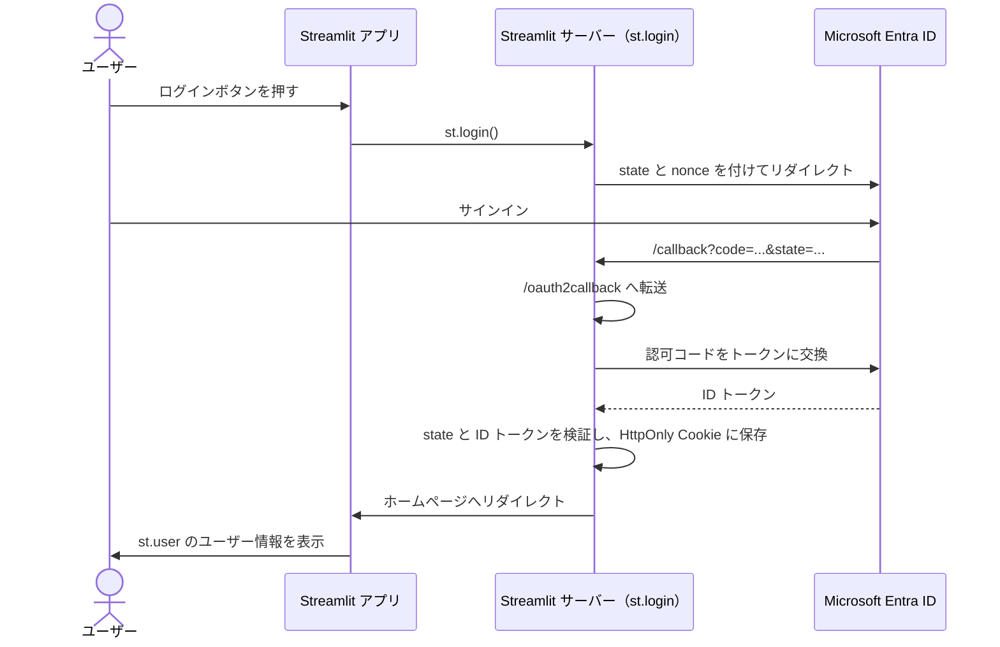

# 🔐 Entra ID Auth Example

[](https://github.com/nncdevel-io/streamlit-auth-with-microsoft-entra-id-example/actions/workflows/ci.yml)


[](LICENSE)

StreamlitアプリケーションにMicrosoft Entra ID（旧Azure AD）認証を組み込むサンプル実装です。

## ✨ 機能

| | 機能 |
| --- | --- |
| 🔑 | Entra IDによるシングルサインオン（SSO） |
| 👤 | IDトークンからのユーザー情報取得 |
| 🚪 | ログイン・ログアウト機能 |
| 🛡️ | 認証必須ページのガード機能 |
| 🍪 | Streamlit 組み込みの `st.login()` による OIDC ログイン（state、nonce、IDトークンの検証、HttpOnly Cookie を Streamlit が処理） |
| 🧭 | `st.navigation()` APIによるマルチページ構成 |

## 📋 必要条件

- Python 3.13以上
- uv
- Microsoft Entra IDテナント
- Azure Portalでのアプリ登録

## 🚀 セットアップ

### 1. 依存関係のインストール

```bash
make install-dev
```

### 2. 環境変数の設定

```bash
cp .env.example .env
```

`.env`ファイルを編集し、Entra IDの設定を入力します。

```bash
AZURE_CLIENT_ID=xxxxxxxx-xxxx-xxxx-xxxx-xxxxxxxxxxxx
AZURE_CLIENT_SECRET=your-client-secret
AZURE_TENANT_ID=xxxxxxxx-xxxx-xxxx-xxxx-xxxxxxxxxxxx
AZURE_REDIRECT_URI=http://localhost:8501/callback

# 認証Cookieの署名に使うシークレット（必須）
# 生成例: python -c "import secrets; print(secrets.token_urlsafe(32))"
AUTH_COOKIE_SECRET=your-random-secret

# 企業プロキシ環境の場合（任意）
SSL_CA_FILE=/path/to/your/ca.pem
```

> [!NOTE]
> **企業プロキシ環境について**: HTTPSトラフィックを検査する企業プロキシの環境では、
> `SSL_CA_FILE`にプロキシのCA証明書パスを設定してください。この値は `st.login()` が
> Entra ID との通信に使う httpx に `verify` として渡します。
> Python 3.13 の SSL 検証（`VERIFY_X509_STRICT`）は有効なままです。

### 3. Azure Portalでのアプリ登録

1. Azure Portal → Microsoft Entra ID → アプリの登録 → 新規登録
2. リダイレクトURIに `http://localhost:8501/callback` を追加
3. 「認証」→「IDトークン」を有効化
4. 「証明書とシークレット」→ クライアントシークレットを作成
5. 「APIのアクセス許可」→ `openid`, `profile`, `email` を追加

## ▶️ 実行

```bash
make run
```

ブラウザで `http://localhost:8501` にアクセスします。

## 🏗️ アーキテクチャ

### マルチページ構成

`server.py` が `st.App` で Streamlit サーバーを起動し、`.env` または環境変数の認証設定を
`st.login()` 用の secrets として渡します。`st.navigation()` APIを使用し、`app.py` がルーター兼共通レイアウトとして機能します。

```bash
server.py           # サーバー起動設定（st.App + 認証設定の secrets + コールバックの転送）
callback.py         # /callback を st.login() の /oauth2callback へ転送するルート
app.py              # エントリポイント（ルーター + 共通レイアウト）
pages/
├── home.py         # ホームページ（ログイン/ユーザー情報表示）
├── about.py        # Aboutページ（認証不要）
├── dashboard.py    # ダッシュボード（認証必須）
└── profile.py      # プロファイル（認証必須）
```

### 認証フロー



1. ユーザーがログインボタンを押すと、`st.login()` が Entra ID へリダイレクトする
2. Entra ID で認証後、`/callback` に認可コード付きで戻り、st.login() のコールバック（`/oauth2callback`）へ転送される
3. Streamlit（Authlib）が state を検証し、認可コードをトークンに交換して ID トークンを検証する
4. ユーザー情報を HttpOnly の Cookie に保存し、ホームページへリダイレクトする
5. アプリは `st.user` からユーザー情報を読み取る

## 💡 使用例

### 基本的な使用例（エントリポイント）

```python
import streamlit as st
from entra_id_auth_example import (
    render_sidebar_account,
    render_site_header,
)

st.set_page_config(page_title="My App", page_icon="🔐")

# 共通レイアウト
render_sidebar_account()
render_site_header()

# ページ定義
pg = st.navigation(
    [
        st.Page("pages/home.py", title="Home", default=True),
        st.Page("pages/about.py", title="About"),
    ]
)
pg.run()
```

### 認証必須ページ

```python
import streamlit as st
from entra_id_auth_example import get_current_user, require_auth

require_auth()  # 未認証ならここで停止（ログインボタン表示）

user = get_current_user()
st.title(f"{user['name']}のダッシュボード")
```

## 🛠️ 開発

### Makefileコマンド

```bash
make install-dev  # 依存関係インストール
make run          # アプリ実行
make test         # テスト実行
make lint         # リンター実行
make type-check   # 型チェック
make check        # lint + type-check
make docs         # APIドキュメント生成
make clean        # キャッシュ削除
```

## 📚 ドキュメント

- [要件定義書](docs/requirements.md)
- [アーキテクチャ設計書](docs/architecture.md)
- [アプリケーション仕様書](docs/specification.md)
- [初期開発のタスク一覧](docs/task.md)
- [作業計画](docs/work/task.md)

本リポジトリは、AIを使った開発のサンプルも兼ねています。
`docs/task.md`は、AIを使った初期開発で用いたタスク一覧です。

## 📄 ライセンス

[MIT](LICENSE)
